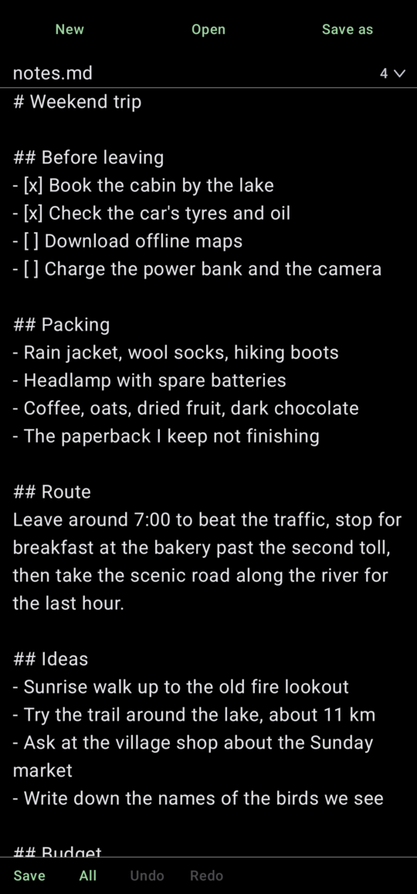
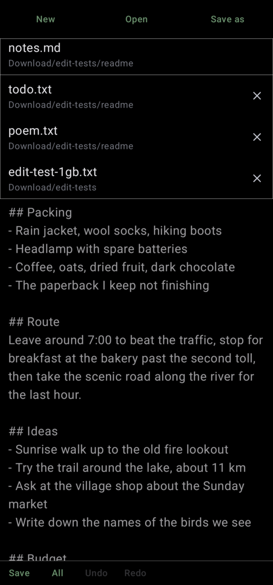
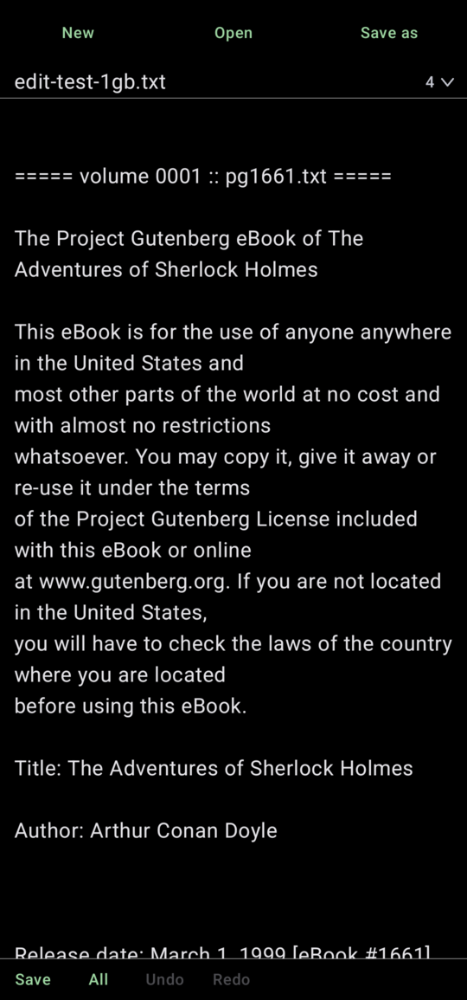
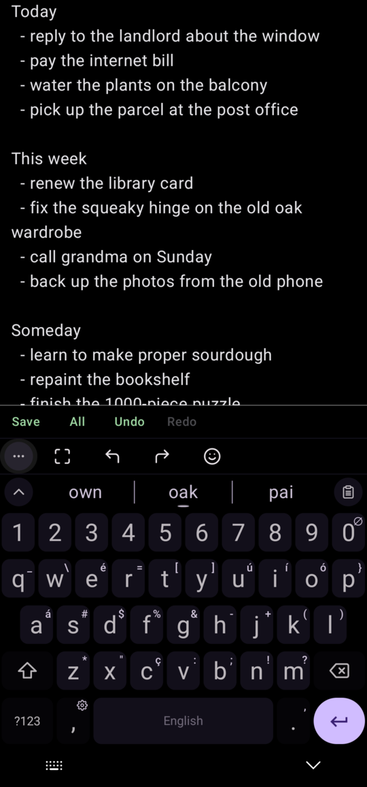
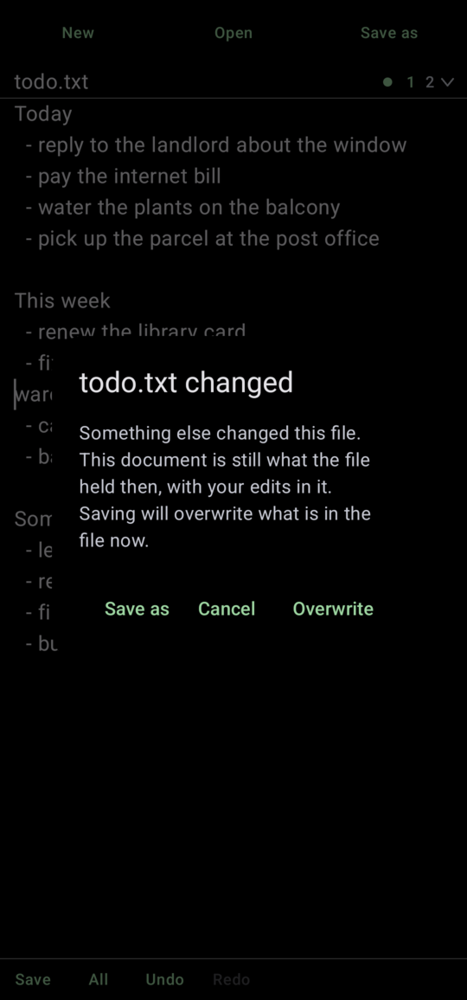
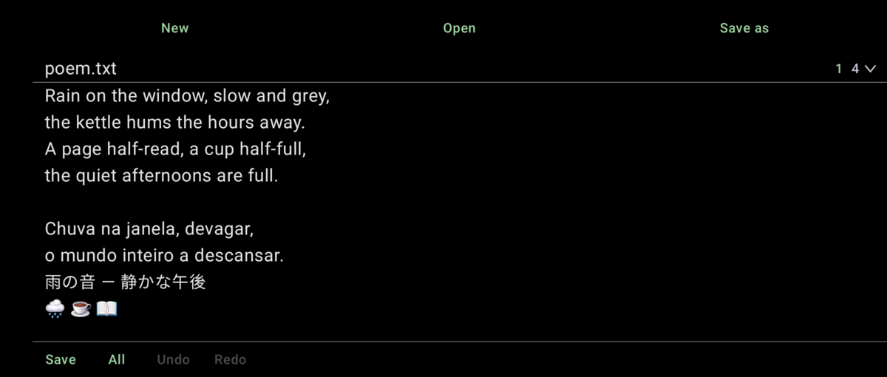

# Edit

Fully AI-generated Android text editor, completely local-first so any sync and encryption tools can handle the files, progress on adding one or more open-source encryption modes is ongoing.

Made when im waiting/idle and have only my phone with me, so i don't waste my plan quota and keep myself busy.

The reason to make it and rationale for why its that way and current progress is at both `AGENTS.md` and `PROGRESS.md`.

Contributions with AI or not are welcome.

<table>
  <tr>
    <td colspan="2" align="center"><br><sub></sub></td>
    <td colspan="2" align="center"><br><sub>Several files open at once</sub></td>
    <td colspan="2" align="center"><br><sub>A gigabyte file</sub></td>
  </tr>
  <tr>
    <td colspan="3" align="center"><br><sub>Typing, with undo and redo. Hidding the top bar dynamically.</sub></td>
    <td colspan="3" align="center"><br><sub></sub></td>
  </tr>
  <tr>
    <td colspan="6" align="center"><br><sub>Any script, either orientation</sub></td>
  </tr>
</table>

Below is just absolutely essential information for people that want to quickly get around this project, written by the model who is making it, so quick small and concise, a complex project to build/develop is an absolute no go anyway.

## Build

Needs JDK 17+ and the Android SDK with `platforms;android-37.0`, pointed at by `sdk.dir` in `local.properties`.

```
./gradlew assembleDebug
adb install -r app/build/outputs/apk/debug/app-debug.apk
```

`./gradlew assembleRelease` for a release build, signed only if a `release.properties` gives `storeFile`, `storePassword`, `keyAlias` and `keyPassword`.

## License

GPL-3.0-or-later: you can redistribute and modify it under the terms of the GNU General Public License as published by the Free Software Foundation, either version 3 of the License, or (at your option) any later version. See `LICENSE`.
